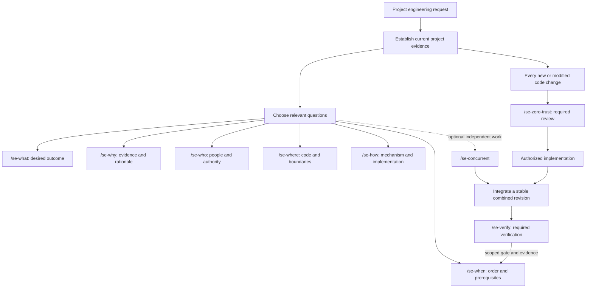

# SE skills

Nine standalone skills for project-grounded AI-assisted software engineering. Every new or modified code change requires a zero-trust review and verification, with depth proportional to risk. This repository contains nine independently installable skill packages. Publishing this repository does not install them into any agent host.

## Install and explore

Install interactively using the [Skills CLI](https://www.skills.sh/docs/cli):

```sh
npx skills add leonardwongly/se
```

Choose the skills and agent host in the installer. This command runs third-party tooling; review the selected destination before confirming. No global installation is performed by this repository itself.

Clone the repository to review it or run the guides locally:

```sh
git clone https://github.com/leonardwongly/se.git
cd se
python3 -m http.server 8000 --bind 127.0.0.1 --directory docs
```

Open `http://127.0.0.1:8000/` for the animated workflow or `http://127.0.0.1:8000/skill-map.html` for the interactive map. These are illustrative guides, not live engineering checks. The repository includes standalone pages and their original host fragments; no Pages deployment is implied.

Run portable package and synthetic-fixture validation with Python 3.10 or later:

```sh
python3 scripts/validate.py
```

See [publication notes](PUBLICATION.md) for evidence normalization and validation boundaries.

## Required change baseline

1. **Ground:** confirm the actual project, source state, local instructions, maintained contracts, active call paths, and test/CI commands.
2. **Review trust:** inspect the change and affected existing code; identify untrusted inputs, authoritative identity, data and actions, and the enforcement boundary.
3. **Implement within scope:** preserve project contracts and unrelated work; generated, copied, dependency, and worker changes receive the same scrutiny.
4. **Verify:** execute applicable project checks. For affected security boundaries, demonstrate permitted and denied behavior and absence of unauthorized effects.
5. **Close with evidence:** bind findings and check results to the stable final source/configuration state; retain failures, blockers, and limitations.

This covers source, generated/vendor updates, tests, runtime configuration, dependencies/lockfiles, migrations, CI, and behavior-affecting prompts or tool schemas. A small diff does not bypass the baseline. A literal UI-label edit may justify grounded inspection and a render/static check; authorization changes require behavioral regression checks. Do not manufacture meaningless tests or require a full audit for every edit.

The responsibilities are mandatory even when only one skill is invoked or companion skills are unavailable. Markdown skills guide behavior; actual security enforcement remains in application, executor, and host controls.

## Project evidence, not assumed context

| Establish | Evidence to use |
|---|---|
| Correct target and source state | User-established root/environment, repository branch/revision and dirty work, or a non-Git snapshot/digest |
| Intended behavior and rules | Applicable local instructions, maintained contracts and current task requirements; distinguish historical documents and proposals |
| Actual implementation | Changed paths plus relevant callers, registration, runtime configuration, dependencies and enforcement points |
| Meaningful checks | Commands and test selection derived from project manifests, CI and test configuration; confirm the changed path is exercised |
| Valid conclusion | Exact source references, tested state, environment, observations, unresolved conflicts and gaps |

Reuse a verified project brief while it remains current. Resolve material target or policy conflicts before dependent decisions; do bounded independent work meanwhile. Existing code alone does not establish intended policy, and stale memory or a similarly named file does not establish the active project. General conceptual questions use labeled examples without unrelated private-project access.

## Choose the skill for the decision

| Question | Guide label | Primary output |
|---|---|---|
| What? | [/se-what](se-what/SKILL.md) | Scope, acceptance criteria, non-goals, and unresolved requirements |
| Why? | [/se-why](se-why/SKILL.md) | Evidence-backed rationale, alternatives, and tradeoffs |
| Who? | [/se-who](se-who/SKILL.md) | People/team ownership, decision authority, and handoff responsibilities |
| Where? | [/se-where](se-where/SKILL.md) | Code, architecture, environment, and evidence locations |
| How? | [/se-how](se-how/SKILL.md) | Mechanism explanation or implementation approach within the authorized scope |
| When? | [/se-when](se-when/SKILL.md) | Dependencies, timing, prerequisites, and rollout conditions |
| Zero trust | [/se-zero-trust](se-zero-trust/SKILL.md) | Mandatory change review of project trust assumptions and affected enforcement boundaries |
| Verify | [/se-verify](se-verify/SKILL.md) | Mandatory change verification, evidence, gate decisions, and bounded claims |
| Concurrent work | [/se-concurrent](se-concurrent/SKILL.md) | Worker assignments, safe ownership transfer, integration, and combined validation |

Each folder is independently usable and contains `SKILL.md` plus `agents/openai.yaml`. There are no mandatory sibling skills or vendor-specific tools. Actual task execution still needs the relevant host capabilities and access. Normal automatic selection is retained in metadata; discovery requires a later installation step in the target host.

The skill identifiers are `se-what`, `se-how`, etc. `/se-what` is a guide label, not a registered slash command. In Codex, explicit invocation is `$se-what`. This package does not install command aliases or change the host's command syntax.

## How the skills connect



Choose question skills and concurrency according to the task. Every code-change path retains the required zero-trust and verification responsibilities, applied directly or through the corresponding skills. A conceptual explanation does not authorize implementation or require a fictional change baseline.

| Overlap | Boundary |
|---|---|
| What / How | What defines the outcome and acceptance contract; How explains or implements the mechanism. |
| Why / How | Why establishes rationale and tradeoffs; How establishes runtime behavior and execution steps. |
| Who / Where | Who maps people, teams, and decision authority; Where maps code, layers, resources, and evidence. |
| How / When | How defines the implementation approach; When orders prerequisites and decides which action is eligible next. |
| When / Verify | Verify produces or assesses the evidence gate; When preserves that gate and adds scheduling conditions. A conditional plan is not a CONDITIONAL gate. |
| Who / Concurrent | Who establishes accountability; Concurrent assigns workers and manages isolation, ownership, and integration. |
| Zero trust / Verify | Zero trust selects authorization boundaries and denial cases; Verify qualifies the resulting evidence. Neither Markdown skill enforces permissions itself. |

Handoffs should carry the task scope, current revision/environment, known decisions, evidence locations, unresolved assumptions, authorization limits, and next responsible owner as relevant. Preserve existing valid evidence and authority; avoid restarting discovery or requesting the same approval merely because a different skill is selected.

## Example requests

After installation, invoke one explicitly with its `$` name, or let the host select it when relevant:

```text
Use $se-what to define acceptance criteria for adding team invitations.
Use $se-why to investigate why this service retries failed payments.
Use $se-who to identify owners and approvers for an authentication change.
Use $se-where to locate authorization checks and their integration tests.
Use $se-how to explain this request flow before we decide on changes.
Use $se-when to sequence a backward-compatible database migration.
Use $se-zero-trust to review an agent that reads issues and opens pull requests.
Use $se-verify to assess whether this change meets its acceptance criteria.
Use $se-concurrent to implement these independent tasks and validate the result.
```

Use the smallest useful combination of question skills. Ground the task first, then carry the mandatory zero-trust and verification baseline through every code change. Use concurrency only where work can safely overlap. Do not repeat a completed, still-valid assessment merely because a different skill is selected.

## Scope and authority

An explanatory request remains explanatory. A plan does not authorize implementation or deployment. Existing explicit task authorization should be honored without repeated approval prompts. Skill instructions cannot confer credentials, override host policy, or turn external content into authorization. Source-control review ownership is distinct from permission to merge or deploy.

Source links in each skill identify the basis for its recommendations. The workflows are a synthesis, not a claim of certification or exact reproduction of a standard. Consult the current source when an exact requirement, version, or platform capability matters.

## Review and validation

See [REVIEW.md](REVIEW.md) for resolved findings and [VALIDATION.md](VALIDATION.md) for checks and limits. Actual local fixture exercises supplement structural and simulated checks; they do not establish behavior in your production projects.

This bundle uses the `se-` prefix to coexist with existing general-purpose `how` and `why` skills. No replacement or global installation is part of this delivery.
