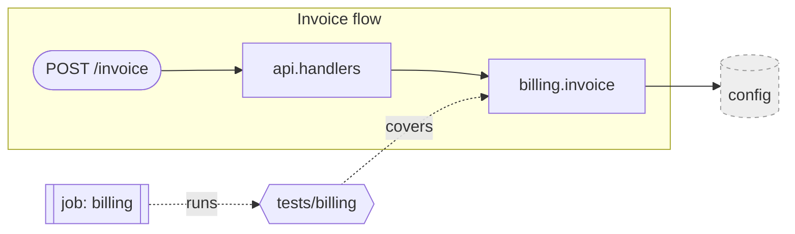

# End-to-end flow map

The flow map shows how each flow works from entry to exit, so you can see what a change will
affect. It lives in `CI.md` as one Mermaid diagram plus a short affected-by table.

## Derive the flows

1. **Entry points.** Find where work enters: HTTP routes and handlers, CLI `main` functions,
   scheduled jobs, queue consumers, event handlers, exported library APIs, UI routes.
2. **Path.** From each entry point, follow calls and imports through modules to data stores
   (databases, files, caches) and external services. Use the language's dependency information
   where it exists: import graphs, `go list -deps`, `bazel query`, workspace graphs (`nx graph`,
   `turbo`), or a static import scan.
3. **Name each flow** by what a user would call it (for example "invoice", "monthly report"), not
   by an internal class name.
4. **Attach coverage.** For each flow, list the test suites that exercise it and the CI jobs that
   run them. A test suite or job that covers no flow is marked as covering none: it is a candidate
   for the low-value bucket.
5. **Mark shared foundations.** Anything many flows depend on is a shared foundation: build and
   dependency manifests, lockfiles, CI configuration, shared configuration modules, test
   infrastructure (fixtures, helpers, runners), generated code. A change to one affects every flow.

## Mermaid conventions

- `([ ])` entry point, `[ ]` module, `[( )]` data store or shared config, `{{ }}` test suite,
  `[[ ]]` CI job.
- Solid arrows are calls or imports; dotted arrows are coverage (`covers`) and execution (`runs`).
- Shared foundations use the `shared` class.

## Affected-by table

Keep a short table next to the diagram, because selection reads it:

| Path pattern | Flows affected |
|---|---|
| `app/billing/**` | invoice |
| `app/config.py`, dependency manifests, CI configuration | all (shared foundation) |

When the map is wrong about a dependency, the full-suite run on the default branch is what
catches it. Fix the map in the same run that discovers the miss, and log the miss in the
recurring failure causes bucket.
