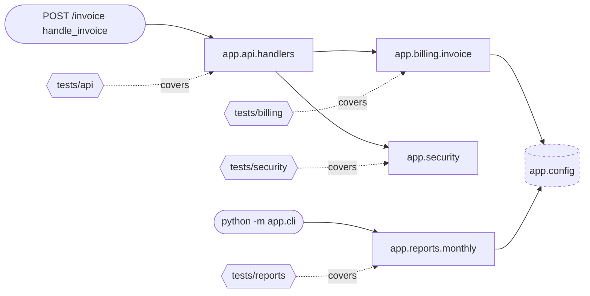

# CI

Revision surveyed: {{HEAD}} on 2026-11-21 · Run: 2 · Method: fallback classification (no decision model available)

## What matters now

1. The install step takes about 40 s of a 64 s median run because dependencies are never cached; cache them and split jobs by flow.
2. `test_invoice_for_random_customer` is flaky (6 of 30 runs) and everyone re-runs it; fix its input generator.
3. `export_csv` has no test, and issue #13 shows it drops the last row.

## Survey coverage

- Surveyed: 12 source files, 11 test files, CI configuration (`.github/workflows/ci.yml`), 6 pull requests, 4 issues, 30 CI runs from `.ci-history/`.
- Not accessible: none; there is no remote, so history comes from the export.
- Reading: direct. The survey is small enough that parallel readers would cost more than they save.

## Required gates

- Security tests run on every pull request (policy SEC-7) — evidence: issue #14, run 7016 caught an injection regression; first seen 2026-10-01; last seen 2026-11-15; impact: compliance; status: open.

## Flaky

- `tests/api/test_handlers.py` `test_invoice_for_random_customer` fails without a code change (6 of 30 runs, n=30) — evidence: runs 7002, 7008, 7017, 7020, 7026, 7029, issue #11; first seen 2026-10-02; last seen 2026-11-14; impact: reruns and lost trust; status: open.

## Slow

- `tests/reports/test_monthly.py` sleeps 3 s for a cache removed in PR #3 — evidence: 3.0-3.2 s in 27 of 30 runs; first seen 2026-10-01; last seen 2026-11-15; impact: most of the test step; status: open.

## Low value

- `tests/billing/test_invoice_copy.py`: `test_subtotal_helper` tests a private helper and never failed in 30 runs; `test_total_again` duplicates `test_total_includes_tax` and failed only with it (run 7007) — first seen 2026-10-01; last seen 2026-11-15; impact: noise; status: open, removal proposed.
- Security tests run twice per run (discover and the gate step) — evidence: `.github/workflows/ci.yml`; impact: small; status: fixed in run 2.

## Coverage gaps

- `app/reports/monthly.py` `export_csv` has no test and drops the last row — evidence: issue #13, PR #6; first seen 2026-10-25; last seen 2026-11-15; impact: shipped bug; status: open.

## Recurring failure causes

- Install timeouts talking to PyPI (3 of 30 runs) — evidence: runs 7005, 7013, 7023; first seen 2026-10-07; last seen 2026-11-04; impact: reruns; status: fixed by caching.
- Flaky random customer test (6 of 30 runs) — see Flaky.

## Infrastructure

- No dependency cache: install takes 38-46 s every run (n=27 successful installs) — evidence: `.ci-history/runs.json`, PR #5; impact: 60% of wall time; status: fixed in run 2 with `cache: pip`.

## Flow map

| Path pattern | Flows affected |
|---|---|
| `app/billing/**` | billing, api |
| `app/api/**`, `app/security.py` | api |
| `app/reports/**`, `app/cli.py` | reports |
| `app/config.py`, `requirements.txt`, `.github/**`, `ci/**` | all (shared foundation) |

## Proposals waiting on approval

- Remove `test_subtotal_helper` and merge `test_total_again` into `test_total_includes_tax` (`tests/billing/test_invoice_copy.py`) — never failed alone in 30 runs; behaviour stays covered by `tests/billing/test_invoice.py`.

## Changelog

- 2026-11-20 {{HEAD}}: first survey; split CI into per-flow jobs with affected-flow selection, a separate security gate and a pip cache — expected PR wall time 64 s → about 20 s.
- 2026-11-21 {{HEAD}}: billing change selects billing and api; reports skipped — No new signal otherwise.
