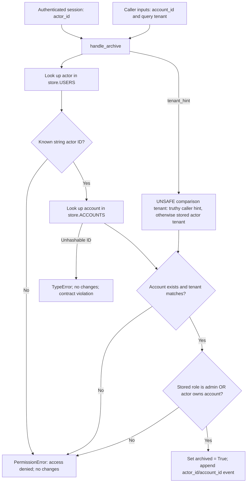

**Do not ship this implementation.** The active transport forwards a caller-controlled tenant query into authorization, allowing an admin to archive another tenant’s account.

The maintained [security contract](../../code-baseline/original-update/docs/security-contract.md#L6) requires identity, tenant, role and ownership to come from stored records. Owners may archive their own account within their tenant; admins may archive accounts only within their tenant. `tenant_hint` must remain compatibility-only.

Follow the tenant input through the current mechanism; the unsafe decision is explicitly labeled:

The [transport](../../code-baseline/original-update/transport.py#L3) supplies session identity and the query tenant separately. [Actor lookup](../../code-baseline/original-update/store.py#L22) correctly rejects unknown actors. However, the [service tenant check](../../code-baseline/original-update/service.py#L6) uses `(tenant_hint or actor['tenant_id'])`. A truthy hint replaces the authoritative tenant. The subsequent admin check bypasses ownership, so it cannot repair that broken tenant boundary. Successful execution changes the account and appends an event; it does not delete anything.

Concrete execution through `handle_archive` confirmed:

| Case | Required result | Observed result |
|---|---|---|
| Alice owns A, both tenant t1, no hint | Archive A and append event | Correct |
| Admin in t1 requests E in t2, no hint | Deny without changes | Correct |
| Same admin and account, hint t2 | Deny without changes | **E archived; event appended** |
| Alice requests A with irrelevant hint t2 | Hint ignored; archive A | Incorrect denial |
| Account ID is a list or dict | `PermissionError('access denied')`; no changes | `TypeError`; no changes |

Before release, keep the public signature, ignore `tenant_hint` for authorization, compare the account tenant with the stored actor tenant, and reject malformed account IDs before dictionary lookup. Retain the owner/admin check. Add regression coverage at both the service and transport boundary, asserting unchanged accounts **and** events on denial. These are proposed repairs; no fixture code was changed.

Validation: Python 3.14.5; `PYTHONDONTWRITEBYTECODE=1 make check` passed its single existing owner test. The separate [contract probe](check_archive.py) exercised ten cases: six passed and four failed, with [raw results](check-results.json). It checks complete account/event state against the maintained contract, not merely exceptions. Its exit status was 1, as expected for the failures.

Scope: isolated non-Git fixture; [source identity](source-identity.json), aggregate SHA-256 `c26337c213a83ef98ba1395391dbb76746939b92dc2a793007d88f8768b405bf`. Evidence is local, in-memory execution. Transport authentication itself is an assumed upstream boundary, not implemented or verified here; there is no hosted provider in this fixture. The static diagram was compared with the source and executed cases; no browser rendering or accessibility conformance was tested. No source edits, installs, commits, external access or deployment occurred.
